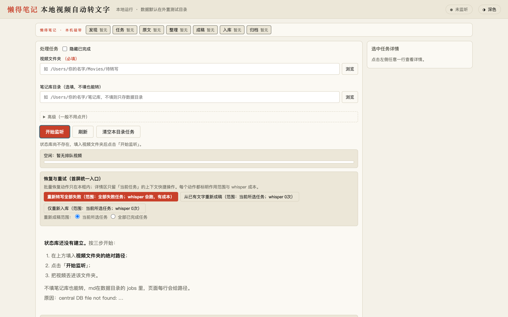

# 懒得笔记 · 本地视频转文字

把课程、会议、采访的视频丢进队列，本机转写成文字并整理成 Markdown 笔记，直接写进 Obsidian 库——全程离线，不上传素材。

[English](./README.en.md)



## 这是什么

一个在 Apple Silicon Mac 上跑的本地转写流水线，带一个只监听 `127.0.0.1:8899` 的控制台页面。

它把「批量处理一堆视频」拆成可恢复的流水线：发现文件 → 抽取音频 → Whisper 转写 → 整理成稿 → 写入 Obsidian。中途失败的任务不会悄悄消失，也不会覆盖你已经改好的笔记。

## 能做什么

- **批量队列**：一次放入多个本地音视频，按任务显示进度与状态。
- **本机转写**：用 `mlx_whisper` 在 Apple Silicon 上转写，不调用云端接口。
- **Markdown 成稿**：转写结果整理成分段笔记，写入指定 Obsidian 库目录。
- **不覆盖成果（No-Clobber）**：目标笔记已存在时默认不覆盖，先提示冲突再决定。
- **可解释的失败**：把「环境缺失、媒体不可读、转写异常、成稿异常、入库受阻、冲突、瞬时异常」分开归类，而不是统一重试。
- **可恢复**：任务状态落库，重启控制台后可以继续，不必从头再来。
- **实时控制台**：普通网页，显示监听状态、当前任务、异常任务、恢复与重试、完成历史。

## 怎么跑起来

需要 Apple Silicon Mac、Python 3.12、`ffmpeg`（`brew install ffmpeg`）。

```bash
python3.12 -m venv .venv
source .venv/bin/activate
pip install mlx-whisper          # 另按 docs 安装其余依赖
./app/start.sh                   # 启动控制台
open http://127.0.0.1:8899/
```

在控制台里选择源目录与 Obsidian 目标目录，确认后加入队列即可。真实视频目录与 Obsidian 库只作为读取/写入目标，仓库内不包含任何素材或笔记。

### 测试

```bash
python3 -m pytest tests
```

## 数据与隐私

- 转写在本机完成，音频与文字不上传云端。
- 控制台只监听回环地址，同一局域网内的其他设备默认访问不到。
- 仓库、测试与示例里没有真实视频、真实笔记或客户信息。

## 已知限制

- 只支持 Apple Silicon（依赖 `mlx_whisper`）；Windows 目录是另一条独立实现线。
- 长视频的耗时与内存占用尚未做完整基线，批量前建议先小规模试跑。
- 源文件被移动或删除时任务会停在「源路径不在位」，需要人工确认后重新绑定。

## 目录

```text
app/            # 本地控制台页面与 Python 服务（仅标准库）
src/stage1..10  # 流水线各阶段：发现、抽取、转写、成稿、入库
tests/          # 流水线与状态机测试
docs/           # 产品计划、评审、QA、交接与治理记录
```

产品范围与当前状态见 `docs/pm/PRODUCT_PLAN.md`，技术评审见 `docs/review/RESEARCH_REVIEW.md`。
